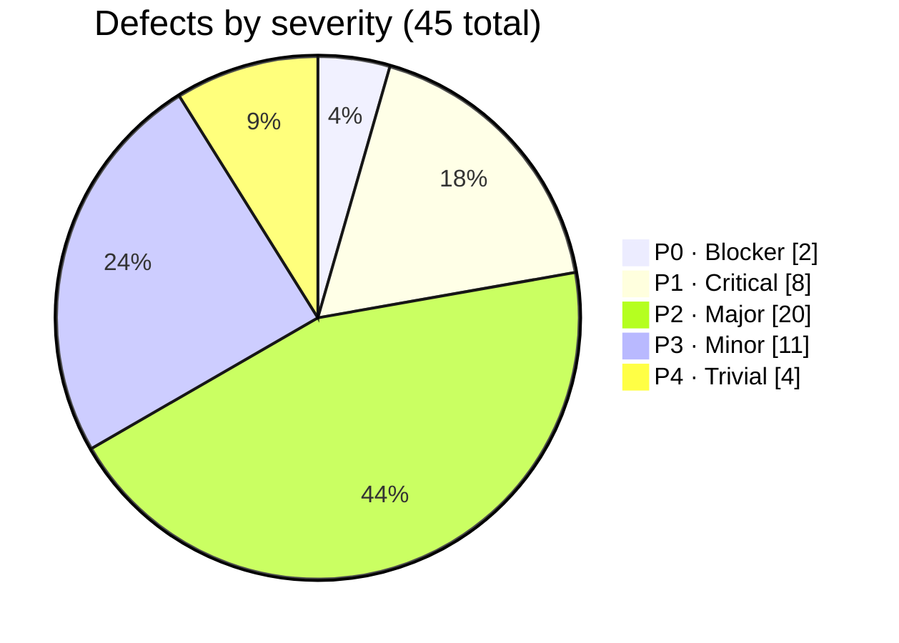
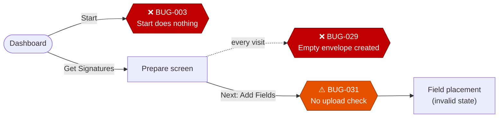

<div align="center">

# 🔍 DocuSign Clone — QA Audit Report

**A side-by-side quality audit of the Scaler AI Labs DocuSign clone against production DocuSign**
<sub>Visual fidelity · End-to-end functional flows · Realism of seeded data</sub>

<br>

[](#-at-a-glance)
[](#-severity-profile)
[](#-fix-these-first)
[](#-fix-these-first)
[](#-severity-profile)
[](#-at-a-glance)

<br>

[At a glance](#-at-a-glance) •
[Severity](#-severity-profile) •
[Fix first](#-fix-these-first) •
[Divergences](#-where-the-clone-diverges) •
[Deliverables](#-deliverables) •
[Scope](#-scope) •
[Rebuild](#%EF%B8%8F-rebuilding-the-deliverables)

</div>

---

> [!IMPORTANT]
> **Verdict:** The clone looks convincing at a glance, but the **primary entry point for sending a document is broken**, and the **Prepare step silently writes junk records on every visit**. Resolve those two blockers and most of what remains is polish.

---

## 📋 At a glance

| | |
|---|---|
| 👤 **Tester** | QA Team |
| 🧪 **Build under test** | `http://13.207.185.159/` *(protected by HTTP basic auth)* |
| 🎯 **Reference** | DocuSign web app, free-trial account |
| 💻 **Environment** | Chrome 153.0.8010.12 · Windows 11 (build 26300) · 1280 × 960 · 100% zoom |
| 📅 **Date** | 03 Oct 2026 |
| 🐞 **Defects logged** | **45**, each with screenshot evidence and reproduction steps |

---

## 📊 Severity profile



| Tag | Level | Count | Definition used in this audit |
|:---:|---|:---:|---|
| 🔴 **P0** | Blocker | **2** | Stops the core send flow or corrupts stored data |
| 🟠 **P1** | Critical | **8** | Core feature broken, or severe UI failure on a main screen |
| 🟡 **P2** | Major | **20** | Incorrect behaviour on a common path, or visible pixel drift on a primary screen |
| 🔵 **P3** | Minor | **11** | Edge cases, secondary screens, subtle visual mismatches |
| ⚪ **P4** | Trivial | **4** | Copy, branding and 1px-level cosmetics |
| | **Total** | **45** | |

> [!TIP]
> A live per-category breakdown is calculated on the **Summary** tab of [`bug_tracker_QA.xlsx`](bug_tracker_QA.xlsx).

---

## 🚨 Fix these first

The diagram below shows where the core sending journey breaks down. Red nodes are blockers; amber nodes are critical validation gaps.



| # | Defect | Severity | Why it comes first |
|:---:|---|:---:|---|
| 1 | **BUG-003** — Home: the primary **Start** button does nothing on click | 🔴 P0 | It is the front door to the product. No new envelope can be started from the dashboard, so every downstream flow is unreachable from its natural entry point. |
| 2 | **BUG-029** — Prepare: each click on **Get Signatures** creates a new, empty envelope record | 🔴 P0 | Silent data corruption with no user confirmation. Every visit leaves an orphaned envelope behind, polluting lists, counters and any model trained on this state. |
| 3 | **BUG-031** — Prepare: **Next: Add Fields** proceeds with no document uploaded | 🟠 P1 | Missing validation lets an envelope reach field placement with nothing to place fields on, producing invalid states further down the flow. |
| 4 | **BUG-0XX** — *[next-highest P1]* | 🟠 P1 | *[one line on user impact]* |
| 5 | **BUG-0XX** — *[next-highest P1 / P2]* | 🟠 P1 | *[one line on user impact]* |

> [!NOTE]
> Rows 4 and 5 are placeholders. Fill them from `bugs.json` before publishing.

---

## 🔀 Where the clone diverges

<details open>
<summary><b>⚙️ Interaction and flow</b></summary>
<br>

The most serious problems sit at the **start of the journey**: the Start CTA, envelope creation on the Prepare screen, and missing guards before field placement. Past those, the remaining issues are mostly **validation gaps** and **navigation inconsistencies** rather than dead ends.

</details>

<details>
<summary><b>🗃️ Seeded data</b></summary>
<br>

Several records do not survive a close read:

- Placeholder names in recipient and sender fields
- Timestamps that never change
- Statuses that contradict the rest of the row
- Page title and meta description expose internal environment naming (`Rl_Docusign`) in every browser tab

</details>

<details>
<summary><b>🎨 Visual fidelity</b> <sub>(measured from computed styles, not by eye)</sub></summary>
<br>

| Element | Clone | DocuSign | Impact |
|---|---|---|---|
| Top navigation height | 64px, `0 16px` padding | 60px | Nav items sit lower than the original |
| Table header text | Uppercase, heavier weight (`NAME`, `STATUS`) | Title case, lighter (`Subject`, `Status`) | Table reads louder than the original |
| Primary button | `#CAC2FF` background, `#130032` text | *[value from original's computed style]* | *[match / mismatch]* |
| Dashboard heading | No `<h1>` present | Page has a top-level heading | Structure and accessibility drift |

</details>

---

## 📁 Deliverables

| Path | Contents |
|---|---|
| 📊 [`bug_tracker_QA.xlsx`](bug_tracker_QA.xlsx) | The tracker: all 14 required columns, severity and category dropdowns, colour-coded severity, live summary counts |
| 📄 [`summary_note.pdf`](summary_note.pdf) | Half-page summary note ([source](summary_note.md)) |
| 🖼️ [`evidence/`](evidence/) | One screenshot per defect, named `BUG-00X_<module>_<slug>.png` to match the tracker |
| 🧾 [`bugs.json`](bugs.json) | **Single source of truth** — the spreadsheet and PDF are generated from it |
| ✅ [`notes/checklist.md`](notes/checklist.md) | Module-by-module coverage checklist |
| ⛔ [`notes/blocked.md`](notes/blocked.md) | Flows that could not be tested past a certain point, and why |
| 📘 [`RUNNING_GUIDE.md`](RUNNING_GUIDE.md) | Full setup and reproduction guide |

> [!WARNING]
> **Blocked testing:** the dashboard **Start** button is unresponsive (BUG-003), so the upload flow was reached through **Get Signatures** instead.

---

## 🎯 Scope

<table>
<tr>
<th width="50%">✅ Covered</th>
<th width="50%">🚫 Excluded</th>
</tr>
<tr valign="top">
<td>

- [x] **Shell & navigation** — login redirect, session persistence across refresh, active nav states, avatar menu, footer links
- [x] **Dashboard** — hero banner, Start, Send with AI, Get Signatures, Sign a Document modal, overview status cards
- [x] **Agreements** — list rendering, search and advanced search, filename handling, seeded-data audit
- [x] **Prepare & send** — envelope creation, recipient validation, email format checks, reminder settings
- [x] **Global behaviour** — modal dismissal (Esc and backdrop), 404 handling, design-token comparison

</td>
<td>

**Per the brief**
- Export and download (CSV, PDF, image, document)
- Third-party integrations (Drive, Notion, Slack, Salesforce)
- Load and performance benchmarking
- Security testing (XSS, SQL injection, brute force, sign-ups)

**By assumption**
- Paid-plan features and billing flows — not visible on the free-trial reference account

</td>
</tr>
</table>

---

## 🛠️ Rebuilding the deliverables

<details>
<summary><b>Click to expand the setup and build commands</b></summary>
<br>

**1. Install dependencies**

```bash
pip install -r requirements.txt
playwright install chromium
```

**2. Re-capture screens, computed styles and console errors**

```bash
python scripts/comprehensive_bug_collector.py
```

**3. Regenerate the tracker and summary PDF from `bugs.json`**

```bash
python scripts/build_deliverables.py --name "QA" \
  --evidence-base https://github.com/<GITHUB_USER>/<REPO>/blob/main/
```

</details>

> [!CAUTION]
> The build **fails fast** with a clear message if any row is missing a required field, uses an invalid severity, repeats an ID, or references an evidence file that does not exist.

---

<div align="center">
<sub>Prepared by the QA Team · 03 Oct 2026 · <a href="#-docusign-clone--qa-audit-report">Back to top ↑</a></sub>
</div>
